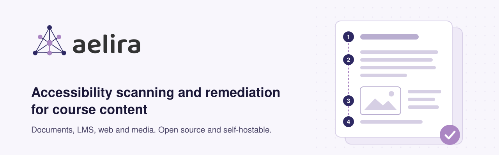
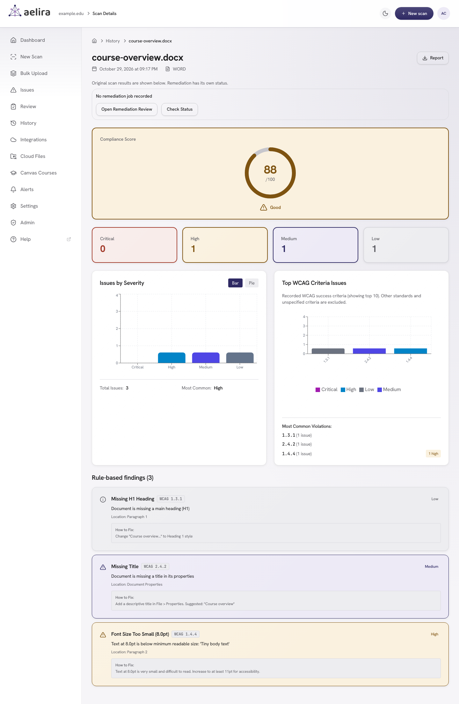
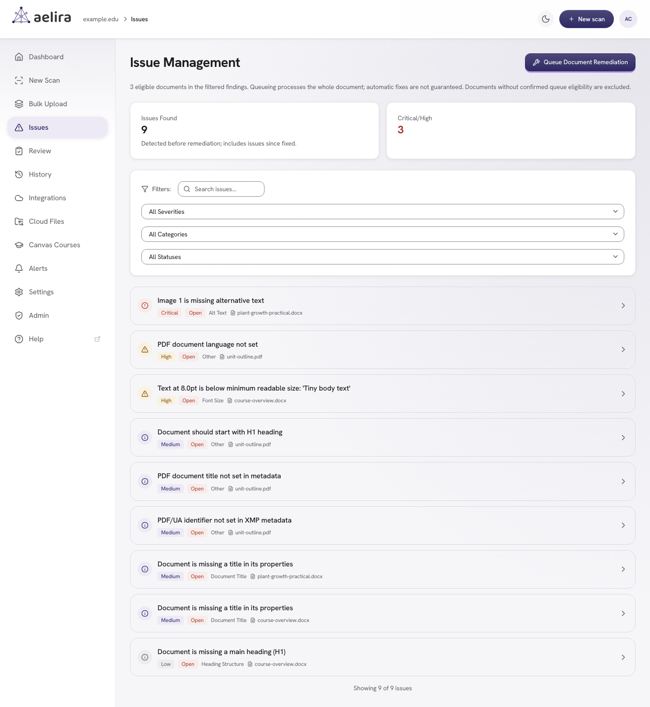
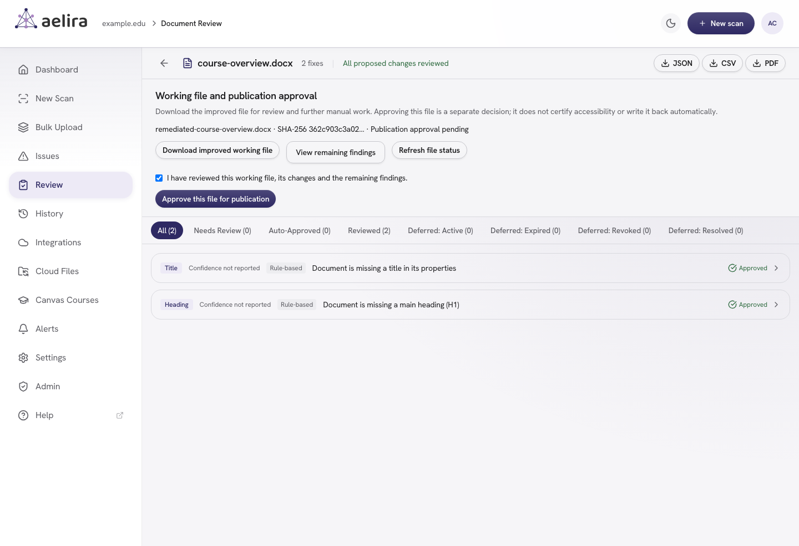
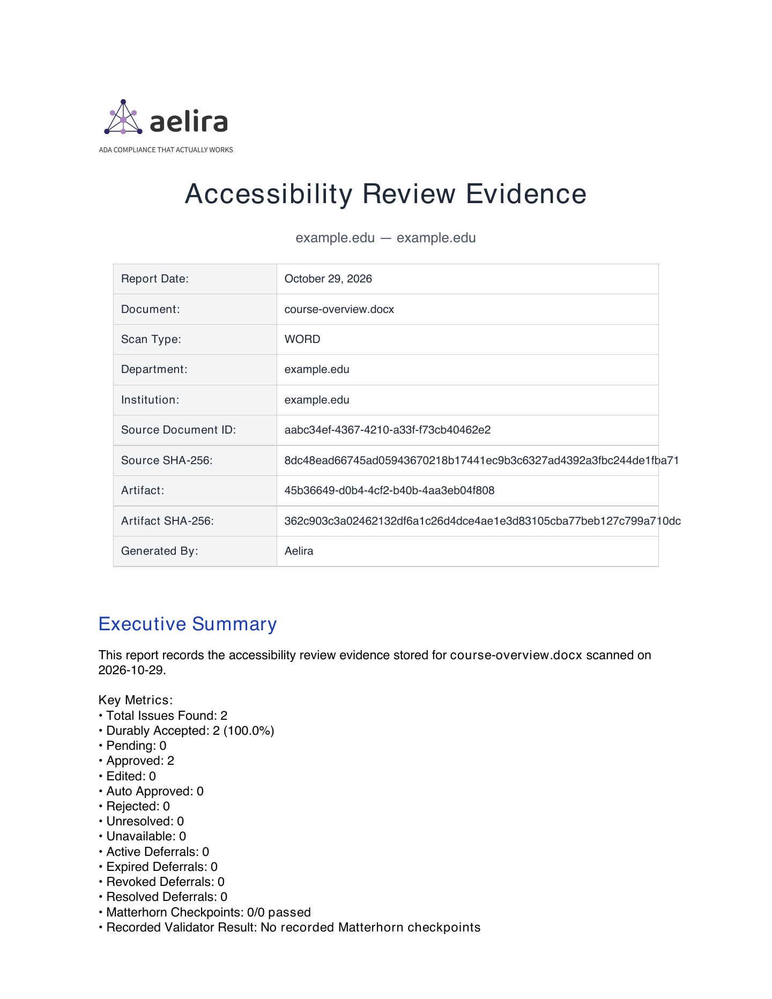
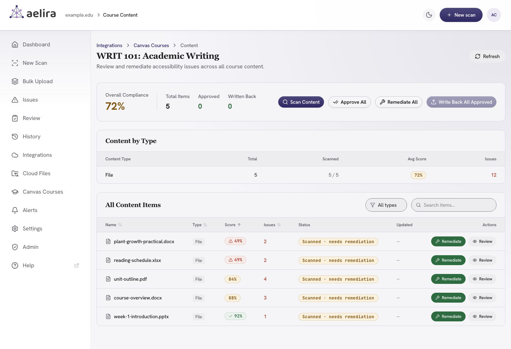
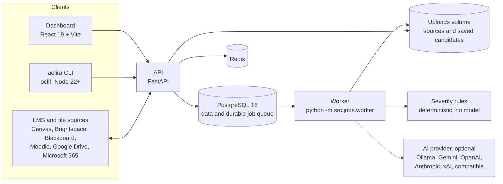

<h1 align="center">
  <picture>
    <source media="(prefers-color-scheme: dark)" srcset="docs/assets/readme/hero-dark.svg">
    <source media="(prefers-color-scheme: light)" srcset="docs/assets/readme/hero-light.svg">
    
  </picture>
</h1>

<p align="center"><strong>Accessibility scanning and supported remediation for course content, with saved-file evidence and human review.</strong></p>

<p align="center">
  <a href="https://github.com/Aelira-AI/aelira-core/releases/latest"></a>
  <a href="LICENSE"></a>
  <a href="https://github.com/Aelira-AI/aelira-core/actions/workflows/ci.yml?query=branch%3Amain"></a>
  <a href="https://github.com/orgs/Aelira-AI/packages?repo_name=aelira-core"></a>
  <a href="https://www.npmjs.com/package/@aelira/cli"></a>
  <a href="CONTRIBUTING.md"></a>
</p>

<p align="center">
  <a href="https://aelira.ai">Website</a> ·
  <a href="https://aelira.ai/docs">Docs</a> ·
  <a href="#try-it-in-one-command">Quickstart</a> ·
  <a href="docs/deployment/self-hosting.md">Self-hosting</a> ·
  <a href="docs/releases/v0.12.2.md">Release notes</a> ·
  <a href="SECURITY.md">Security policy</a> ·
  <a href="CONTRIBUTING.md">Contributing</a>
</p>

> **Status: 0.12.2 beta.** Scanning and remediation remain under active validation. Automated scores describe scanner findings, not accessibility conformance. A verified improved PDF can remain downloadable as a working file while manual work remains; unsupported or unsafe cases can still have no downloadable candidate. Publication requires separate review and approval. LMS integration maturity varies by platform (see the [integration status table](#lms-integration-status) below). Cloud and uploaded scans, remediation, upload, synchronization, and reconciliation jobs use a bounded, multi-worker durable queue. See the [0.10.0 release notes](docs/releases/v0.10.0.md) for upgrade actions and verification limits.

Aelira can apply eligible fixes and return a saved candidate with a report of recorded outcomes. Supported changes differ by format and source structure, and unsupported or ambiguous cases remain unresolved. Review the actual saved file and remaining findings before approving publication.

It is built for institutions working toward WCAG 2.1 AA, including US public entities under the DOJ ADA Title II rule (**26 April 2027** for jurisdictions of 50,000+, **26 April 2028** for smaller entities). The whole self-hosted product is free and open source under AGPL-3.0.

## Try it in one command

```bash
git clone https://github.com/Aelira-AI/aelira-core.git
cd aelira-core
docker compose -f docker-compose.quickstart.yml up -d
```

No `.env` file, no configuration. When it comes up:

- API and interactive docs: <http://localhost:8000/docs>
- Health check: <http://localhost:8000/health>

That gets you scanning immediately, with AI disabled. AI-generated fixes need a provider, and open-core does not choose one for you: set `LLM_PROVIDER` to `gemini`, `openai`, `anthropic`, `xai`, or `ollama`, then supply that provider's key or local endpoint. Point `openai` at any OpenAI-compatible endpoint, or run fully local AI with:

```bash
LLM_PROVIDER=ollama EMBEDDING_PROVIDER=ollama docker compose -f docker-compose.quickstart.yml --profile ollama up -d
```

Fallback is opt-in through `LLM_FALLBACK_PROVIDER`. Nothing is sent to an AI service you did not select. The quickstart is for evaluation; use the [self-hosting guide](docs/deployment/self-hosting.md) for production.

## What it does

| Area | What you get |
|---|---|
|  **Scans** | PDF, Word, PowerPoint, Excel and LaTeX documents; web pages with axe-core and Pa11y; audio and video; images. Severity comes from fixed rules, not a model. |
|  **Remediates** | Bounded, format-specific fixes where the file exposes a safe target: tags, metadata, bookmarks, tables, alternative text, OCR text layers, MathML, and WebVTT captions as a separate file. Unsupported or ambiguous cases stay open. |
|  **Connects to your LMS** | Canvas, Brightspace (D2L), Blackboard and Moodle, plus Google Drive and Microsoft 365. Maturity differs by platform; see the [status table](#lms-integration-status). |
|  **Records review and evidence** | Reviewers approve the exact saved candidate before publication or write-back. [Evidence packages](docs/EVIDENCE_PACKAGES.md) bind scan observations, reviewer decisions, validator results and file hashes into a portable ZIP. |

### Four equal product pillars

For document work, scan an original file, apply supported changes, and review any saved candidate and unresolved findings. The public core treats **documents**, **LMS**, **web**, and **media** as four equal product pillars, each with its own implementation and evidence boundaries.

| Pillar | Scope | Start here |
|---|---|---|
| **Documents** | PDF, DOCX, PPTX, XLSX, and LaTeX scanning, bounded remediation, review artifacts | [Document remediation hub](docs/document-remediation/README.md) |
| **LMS** | Course discovery, scanning, remediation policy, and provider-specific write-back | [LMS integration status](#lms-integration-status) |
| **Web** | Browser-based accessibility detection and code remediation | [`src/education/web_scanner.py`](src/education/web_scanner.py) |
| **Media** | Audio/video transcription, captions, and related review outputs | [`src/education/multimedia_processor.py`](src/education/multimedia_processor.py) |

<details>
<summary><strong>Format-by-format coverage: what each content type gets</strong></summary>

<br>

| Content | What it does |
|---|---|
| **PDF** | Scans text/OCR and structure; applies bounded metadata, tag, bookmark, table, and alt-text fixes where the file exposes a safe target. Eligible image-only pages are OCR'd in a private working copy and the searchable text is preserved in the delivered PDF; ambiguous or unsupported cases fail closed. |
| **Word, PowerPoint, Excel** | Format-specific structure, alternative-text, contrast, table, slide, and workbook checks with partial original-format remediation |
| **LaTeX** | Remediates and returns `.tex` source directly, converts supported equations to MathML, keeps any model-drafted equation description as a review draft that is never written as a label, and can optionally produce PDF/HTML |
| **General STEM visuals** | Defines source-bound, specialist-specific contracts for printed, multi-equation, vector, and handwritten mathematics; chemical formulas and molecular structures; commutative diagrams; and mixed visuals. The PDF remediation pipeline runs the printed equation and handwritten mathematics paths in this release; the multi-equation, vector, chemical formula, molecular structure, commutative diagram and mixed visual paths are not used by it. Saved-file verification and exact-candidate human approval remain mandatory. |
| **Web pages** | axe-core and Pa11y detection, with generated code fixes |
| **Video and audio** | Transcription, with generated WebVTT captions delivered as a separate file for human review; structure is checked, accuracy is not |
| **Images** | Context-aware alt text, not filename echoes |

MathML is one stage of the LaTeX pipeline; the source remains first-class. Source-level remediation can improve accessibility metadata and language, figures, tables, equations, and links, depending on the issues found. With AI configured, figure descriptions use the issue, location, and original LaTeX context rather than the filename alone, with a filename-based fallback when richer context is unavailable.

Capabilities, dependencies, evidence level, and review limits for every document format are in the [document remediation hub](docs/document-remediation/README.md). The [General STEM guide](docs/document-remediation/general-stem.md) documents the visual trust pipeline and its limits.

</details>

### LMS integration status

Connectors can read course content from supported LMS deployments, **Google Drive** and **Microsoft 365**. Permissions, supported operations and verification maturity differ; review and authorized write-back are separate steps. We label each connector honestly rather than imply parity, so check your platform before you depend on it:

| LMS | Connection | Status |
|---|---|---|
| **Canvas** | LTI 1.3 + REST API | **Integration verified**: tested against a live Canvas instance; institution-specific user-journey acceptance remains necessary |
| **Brightspace (D2L)** | LTI 1.3 + API | **Beta**: built and tested against a D2L developer instance, not recently re-verified |
| **Blackboard** | LTI 1.3 + API | **Experimental**: implemented, not yet tested end to end |
| **Moodle** | REST API | **Experimental**: implemented, not yet tested end to end |

If you run one of the experimental integrations, we would value the feedback: open an issue with what you find. Canvas administrators can start with the [Canvas LTI guide](docs/deployment/canvas-lti.md).

## Screenshots

Captured from a deployment of a released version with generic demo files, by [`dashboard/tests/readme/screenshots.capture.ts`](dashboard/tests/readme/screenshots.capture.ts). [How to regenerate them](docs/assets/readme/screenshots/README.md).

**Scan results.** Each finding names its WCAG criterion, where it is and how to fix it.



**Issue review.** Findings from every scanned document in one list, with filters.



**Remediation review.** A reviewer approves each change, then the exact saved working file, identified by its SHA-256.



**Review evidence.** The evidence export records the source and output hashes and every review decision.



**Canvas course.** Course files scanned in place, ready to remediate, review and write back.



## Architecture



In words: the dashboard, the `aelira` CLI and LMS connections all talk to the FastAPI service. The API validates tenant scope and writes jobs to a durable queue in PostgreSQL; it never runs them. A separate worker process runs scans, browser sessions, transcription and remediation, and writes saved files to the shared uploads volume. Severity is assigned by fixed rules in code. An AI provider is optional, used only for generated text such as explanations and draft descriptions, and only the provider you configure is called. The [self-hosting guide](docs/deployment/self-hosting.md#api-and-worker-topology) describes the topology in full.

<details>
<summary><strong>Source layout and technology stack</strong></summary>

<br>

```
src/
  education/     document processors: PDF, Office, LaTeX, web, multimedia
  ai/            provider abstraction, WCAG knowledge base, severity rules
  integrations/  Canvas, Blackboard, Moodle, Brightspace, Google, Microsoft
  jobs/          durable queue worker and readiness checks
  api/           FastAPI routes
  auth/          magic link, OAuth, API keys, sessions
dashboard/       React 19 + Vite admin interface
cli/             oclif command-line client (TypeScript, Node 22+)
alembic/         database migrations
tests/           pytest suite
```

| Layer | Stack |
|---|---|
| API | FastAPI, Python 3.12+ (published images use 3.14), SQLAlchemy 2.1 |
| Storage | PostgreSQL 16, Redis |
| Dashboard | React 19, Vite, TypeScript, Tailwind |
| CLI | oclif, TypeScript, Node 22+ |
| AI | Bring your own: Gemini, OpenAI, Anthropic, xAI, any OpenAI-compatible endpoint, or fully local via Ollama |
| PDF | pikepdf, PyMuPDF, pdfplumber, OCRmyPDF |
| Office | python-docx, python-pptx, openpyxl |
| Web | Playwright, axe-core, Pa11y |
| Media | faster-whisper, PySceneDetect, FFmpeg |
| OCR & print | Tesseract (via OCRmyPDF), Ghostscript, qpdf |
| LaTeX & conversion | TeX Live (pdflatex/LuaTeX), LaTeXML, Pandoc |

The annotated dependency inventory is in [docs/DEPENDENCIES.md](docs/DEPENDENCIES.md). Production dependencies are pinned in [requirements.txt](requirements.txt); contributors install the complete runtime and tooling set through [requirements-dev.txt](requirements-dev.txt).

</details>

## How it stays honest

**Human review comes before publication.** Aelira returns a saved candidate and a report of recorded outcomes. Nothing is published or written back to an LMS until a reviewer approves that exact candidate. A verified improved PDF can be downloaded as a working file while manual corrections remain, and unsafe or unsupported output is withheld.

**Evidence is the saved file.** Checks run against the file that was actually written, not against a plan of intended fixes. An [evidence package](docs/EVIDENCE_PACKAGES.md) records source and output identity, scan observations, reviewer decisions, validator results and audit history. It is provenance, not a conformance certificate, legal determination, or proof that a reviewer decided correctly.

**Automated scores are not conformance.** A score describes what the scanners found. It does not establish that content meets WCAG 2.1 AA.

### Severity is computed, not generated

Aelira uses AI to write explanations. It does **not** use AI to decide how serious a violation is. Severity comes from [`src/ai/severity_rules.py`](src/ai/severity_rules.py), a plain function of the rule that fired and the scanner's impact rating. It performs no I/O, holds no state, and calls no model.

The same file therefore produces the same severities on every run, including when your AI provider is rate-limiting or down. Language models sample, so anything that asks one to rate severity will eventually disagree with itself; setting `temperature=0` does not fix that. If your compliance reports have to be reproducible, this matters more than any feature list. A test fails if a single severity varies across repeated runs:

```bash
pytest tests/test_severity_determinism.py
```

<details>
<summary><strong>How explanations are grounded in the bundled WCAG corpus</strong></summary>

<br>

On first startup, Aelira seeds its bundled WCAG corpus. Known scanner rule IDs use exact corpus lookup, so this grounding works with every generation provider and needs no embedding service. Optional free-text semantic search is enabled separately with `EMBEDDING_PROVIDER=ollama`; only then does startup generate missing Ollama embeddings. The explicit scripts remain available for operator repair:

```bash
python scripts/seed_wcag_guidelines.py
python scripts/generate_wcag_embeddings.py
```

Export `DATABASE_URL` before running these repair commands. The embedding repair uses `OLLAMA_HOST` and `OLLAMA_EMBEDDING_MODEL`; it preserves existing vectors and returns nonzero if rows fail or are busy. Downloading a missing model requires an explicit `--pull` option.

</details>

## Self-hosting

Aelira Core runs entirely on your own infrastructure. It needs PostgreSQL, Redis, and optionally Ollama for local inference. There is no dependency on a hosted Aelira service.

Three settings point the system at your deployment, and everything user-facing derives from them:

```bash
PUBLIC_API_URL=https://accessibility-api.your-university.edu
PUBLIC_DASHBOARD_URL=https://accessibility.your-university.edu
CORS_ORIGINS=https://accessibility.your-university.edu
```

The production compose file runs the full stack (API, worker, dashboard, PostgreSQL, Redis, optional Ollama) from the published multi-architecture images:

```bash
cp .env.example .env   # replace the production secret placeholders
docker compose -f docker-compose.prod.yml up -d
```

Production Compose supplies service-local PostgreSQL and Redis URLs and `ENV=production` unless you explicitly override them. The commented localhost examples in `.env.example` are for running the API directly on the host. Every variable the code reads is documented in [`.env.example`](.env.example).

Read next: the [self-hosting guide](docs/deployment/self-hosting.md) (backups, TLS, monitoring, upgrades), [local AI model recommendations and hardware tiers](docs/deployment/local-ai-models.md), and the [LMS AI policy, readiness, egress, and revocation guide](docs/deployment/lms-ai-policy.md).

<details>
<summary><strong>Data handling and optional analytics</strong></summary>

<br>

**A note on data.** Local Ollama inference can keep AI processing on institution-controlled infrastructure when local providers are deliberately configured. Review fallback providers, storage, logs, backups, network egress and access controls for the actual deployment. Local inference alone does not establish FERPA compliance or replace an institutional privacy review.

**A note on analytics.** The dashboard ships with an optional, off-by-default [Umami](https://umami.is/) integration (Umami is open-source, self-hostable web analytics). It activates when you configure `VITE_UMAMI_WEBSITE_ID` and `VITE_UMAMI_URL`, and loads after analytics consent. Review the configured destination and the deployment's network behaviour before making a telemetry or data-residency claim.

</details>

## Versioning

Aelira Core follows [Semantic Versioning](https://semver.org/spec/v2.0.0.html) from 0.10.0. While the major version is 0:

- Minor releases (0.MINOR.0) carry new features or breaking changes, and each one is listed under Operator action required in its release notes.
- Patch releases (0.x.PATCH) carry only backwards-compatible fixes and security updates.
- 1.0.0 comes when the API and CLI contracts are declared stable.

Releases 0.9.1 to 0.9.13 were published as patch releases but included new features, database migrations and breaking changes. Read the release notes for each version before you upgrade across them.

This policy is enforced by tooling. The release workflow runs `scripts/verify_semver_bump.py` and refuses a tag that does not increase the version, skips a number, or is a patch whose CHANGELOG section has any heading other than Fixed, Security or Dependencies, or that adds an Alembic migration. It also refuses a tag while the Unreleased section still has entries. Every pull request must add a CHANGELOG entry or state why it needs none, and a non-blocking check prints the smallest bump the Unreleased section already requires. See [CONTRIBUTING.md](CONTRIBUTING.md#changelog-entries-and-version-bumps) for how to write entries.

## Development

```bash
./setup-dev.sh  # Docker Compose plugin + jq; builds, migrates, and waits for readiness
docker compose -f docker-compose.dev.yml exec api pytest
```

AI is disabled by default. To choose local inference, run `LLM_PROVIDER=ollama ./setup-dev.sh`; add `EMBEDDING_PROVIDER=ollama` only when semantic retrieval is wanted. Existing `.env` values are preserved. The dashboard runs separately with `cd dashboard && npm install && npm run dev`.

The [development setup guide](docs/development/onboarding.md#2-full-dev-stack-docker-composedevyml) covers credentials, custom models, Compose overrides and authenticated smoke tests. Runnable library, API and CLI examples are in [`examples/`](examples/README.md).

## Command line

`aelira` scans and remediates content from the terminal against any Aelira Core API: the quickstart above, a self-hosted deployment, or your own.

```bash
npm install -g @aelira/cli
aelira --help
```

It lives in [`cli/`](cli/) if you prefer to run it from source (`npm ci && npm run build && ./bin/run.js`).

<details>
<summary><strong>How the CLI chooses which API to call</strong></summary>

<br>

Network commands resolve the API endpoint in this order:

1. An explicit `--api-url`
2. `AELIRA_API_URL`
3. The active profile's `apiUrl`, set with `aelira config set api-url <url>`
4. `http://localhost:8000`

Configure a self-hosted deployment once, or override it for a single command:

```bash
aelira config set api-url https://api.example.edu
aelira report analytics
aelira report analytics --api-url http://localhost:8000
```

</details>

## What is not here

- **Billing, CRM, campaign and helpdesk integrations.** They run the commercial service and have nothing to do with remediation.
- **Hosted infrastructure and support.** These are the commercial offering. The self-hosted core has no paid feature tier; its current beta scope and validation limits apply whether you self-host or use managed infrastructure.

If you self-host and never pay us anything, the tool still works. That is the point of the licence.

## Built on

Aelira Core stands on excellent open-source tools: [axe-core](https://github.com/dequelabs/axe-core) and [Pa11y](https://pa11y.org/) for web accessibility rules, [Tesseract](https://github.com/tesseract-ocr/tesseract) and [OCRmyPDF](https://github.com/ocrmypdf/OCRmyPDF) for OCR, [pikepdf](https://github.com/pikepdf/pikepdf), [PyMuPDF](https://github.com/pymupdf/PyMuPDF), qpdf and Ghostscript for PDF surgery, [LaTeXML](https://math.nist.gov/~BMiller/LaTeXML/) and TeX Live for maths accessibility, [Pandoc](https://pandoc.org/) for format conversion, [FFmpeg](https://ffmpeg.org/) and [faster-whisper](https://github.com/SYSTRAN/faster-whisper) for captioning, and [Playwright](https://playwright.dev/) for browser automation. Their licences ship with their packages; this project would not exist without them.

## Contributing

Issues and pull requests are welcome. See [CONTRIBUTING.md](CONTRIBUTING.md) for the workflow and [CODE_OF_CONDUCT.md](CODE_OF_CONDUCT.md) for expectations. Browse [good first issues](https://github.com/Aelira-AI/aelira-core/labels/good%20first%20issue) or [help wanted](https://github.com/Aelira-AI/aelira-core/labels/help%20wanted) to find work to discuss.

Questions, setup help and feature ideas belong in [Discussions](https://github.com/Aelira-AI/aelira-core/discussions), and reproducible bugs go to the issue tracker. [SUPPORT.md](SUPPORT.md) helps you choose between them.

Technical maintenance is led by [RD (Reg) Crampton](https://github.com/rdcrampton), with the [Aelira-AI-Dev](https://github.com/Aelira-AI-Dev) project administration account. [Governance](GOVERNANCE.md) describes maintainer and contributor responsibilities, review and access.

Follow Aelira: [Website](https://aelira.ai) · [LinkedIn](https://www.linkedin.com/company/aelira-ai) · [X](https://x.com/Aelira_dot_AI) · [Release announcements](https://github.com/Aelira-AI/aelira-core/discussions/categories/announcements)

## Support the project

Aelira Core is free and open source, and maintaining it takes steady work: dependency and security updates, native rebuilds, release evidence and review of every change. If your institution or team relies on it, you can help in several ways:

- **Sponsor the project** through [GitHub Sponsors](https://github.com/sponsors/Aelira-AI). Sponsorship funds maintenance and security work on the open-source code.
- **Report what you find.** Bug reports, accessibility findings from real course material, and documentation gaps all make the project better.
- **Contribute** fixes, tests or documentation (see [Contributing](#contributing)).
- **Run a pilot** at your institution and tell us what works and what doesn't, through [Discussions](https://github.com/Aelira-AI/aelira-core/discussions).
- **Star and share** the repository so other accessibility teams can find it.

### Sponsors

Institutions sponsoring at the Institution tier are shown here. None yet; see [SUPPORTERS.md](SUPPORTERS.md) for everyone who supports the project.

## Security

Please do not report vulnerabilities in public issues. Follow the private reporting process in the [security policy](SECURITY.md), which also lists the supported versions. Known unfixed advisories and security backports are documented under [`docs/security/`](docs/security/).

## Licence and branding

[AGPL-3.0](LICENSE). You can run it, modify it, and self-host it, including inside an institution. If you offer it to others as a network service, your modifications have to be published under the same licence.

One deliberate exception: the command-line client in [`cli/`](cli/) is [MIT-licensed](cli/LICENSE), so institutions and vendors can embed or script against it without AGPL obligations. The engine the CLI talks to remains AGPL.

The code is AGPL. The **name and logos are not**; see [BRANDING.md](BRANDING.md). You can also replace the branding entirely with environment variables rather than forking, which is the supported path for an institution that wants this under its own name. README icons are from [Heroicons](docs/assets/readme/icons/README.md) (MIT).
