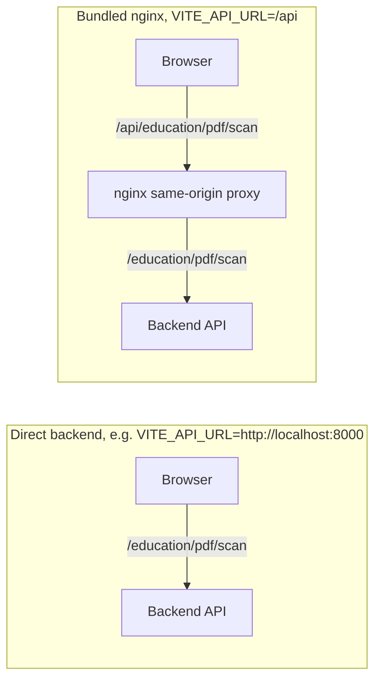

<h1 align="center">Aelira Dashboard</h1>

<p align="center"><strong>The customer-facing dashboard for the Aelira accessibility scanning platform.</strong></p>

<p align="center">
  <a href="package.json"></a>
  <a href="package.json"></a>
  <a href="package.json"></a>
</p>

<p align="center">
  <a href="#getting-started">Getting started</a> ·
  <a href="#environment-variables">Environment variables</a> ·
  <a href="#design-system">Design system</a> ·
  <a href="#accessibility">Accessibility</a> ·
  <a href="#deployment">Deployment</a> ·
  <a href="#api-integration">API integration</a>
</p>

A React and TypeScript single-page app that talks to the FastAPI backend.

| Area | What it covers |
|---|---|
|  **Scanning** | Document and website scanning |
|  **Issues and reporting** | Issue tracking and compliance reporting |
|  **Canvas** | Canvas LTI integration |

## Tech stack

Versions below are read directly from [`package.json`](package.json); check there for the current pinned ranges.

| Concern | Choice |
|---|---|
| UI framework and build | **React 19** with **Vite 8** for the dev server and build |
| Routing | **React Router 7** for client-side routing |
| Language | **TypeScript 5**. The entire `src/` tree is `.ts`/`.tsx`, with no `.jsx`. |
| Styling | **Tailwind CSS 4** with a custom semantic design token system |
| Server state | **TanStack Query** for server-state caching |
| API client | **Axios** |
| Charts | **Recharts** |
| Icons | **Lucide React** |
| Testing | **Playwright** for end-to-end tests, **axe-playwright** for automated accessibility scans |

## Getting started

### Prerequisites

- Node.js 22+ (matches CI and `dashboard/Dockerfile`)
- npm

### Setup

```bash
# Install dependencies
npm install

# Start the dev server (default: http://localhost:5173)
npm run dev

# Type-check separately (build does not run TypeScript checks)
npx tsc --noEmit

# Build for production (vite build)
npm run build

# Preview the production build locally
npm run preview

# Lint
npm run lint
```

### Tests

```bash
npm run test        # Playwright end-to-end tests
npm run test:ui     # Playwright with the interactive UI runner
npm run test:auth   # Just the auth flow spec (tests/auth.spec.ts)
npm run test:unit   # Node's built-in test runner over tests/unit/*.test.js
npm run test:all    # Unit tests + full Playwright suite
```

## Environment variables

Copy [`.env.example`](.env.example) to `.env` and fill in real values. Everything in `.env.example` is authoritative; this section mirrors it.

| Variable | Required | Purpose |
|---|---|---|
| `VITE_API_URL` | Yes | Backend API base URL. `http://localhost:8000` in development, your API domain in production. Read in `src/api/client.ts`, `src/api/ltiClient.ts`, and elsewhere. |
| `VITE_BRAND_NAME` | No | Display name for the dashboard. Keep it aligned with the backend `BRAND_NAME`. |
| `VITE_LOGO_LIGHT` | No | Logo path for the light theme. |
| `VITE_LOGO_DARK` | No | Logo path for the dark theme. |
| `VITE_PRIVACY_POLICY_URL` | No | Your deployment's privacy policy. Set it before onboarding users; no hosted Aelira policy is used when it is unset. |
| `VITE_UMAMI_WEBSITE_ID` | No | Umami (privacy-focused, open-source analytics) website ID. Only loads when the user consents to analytics cookies via the cookie banner. |
| `VITE_UMAMI_URL` | No | Umami instance URL, paired with the ID above. |

`VITE_DEV_MODE` is not read by the dashboard source and does not enable a Settings banner or bypass backend authentication.

## Design system

The dashboard uses a semantic CSS-variable token system for automatic light and dark theming, defined in [`src/index.css`](src/index.css).

| Kind | Classes |
|---|---|
| Text | `.text-primary`, `.text-secondary`, `.text-tertiary`, `.text-accent` |
| Backgrounds | `.bg-surface-primary`, `.bg-surface-secondary`, `.bg-surface-tertiary` |
| Components | `.input`, `.card`, `.btn-primary`, `.btn-secondary` |

Prefer these over inline `dark:` Tailwind utilities. They keep theming centralized in `src/index.css` instead of scattered across components.

Dark mode is controlled by the `dark` class on `<html>`, managed by `ThemeContext` (`src/context/ThemeContext.tsx`) and toggled via `ThemeToggle` (`src/components/ThemeToggle.tsx`), which calls `useTheme()` rather than touching `classList` directly.

<details>
<summary><strong>Example token definitions</strong></summary>

<br>

```css
/* src/index.css: light mode */
:root {
  --content-primary: #1F1D1A;
  --content-secondary: #5C564D;
  --surface-primary: #FDFBF7;
  /* ... */
}

/* dark mode */
.dark {
  --content-primary: #F5F2ED;
  --content-secondary: #B5AFA5;
  --surface-primary: #1A1816;
  /* ... */
}
```

The exact hex values above live only in `src/index.css`. Treat that file as the source of truth; it changes independently of this README.

</details>

<details>
<summary><strong>Project structure</strong></summary>

<br>

```
dashboard/
├── src/
│   ├── api/              # API clients (client.ts, ltiClient.ts)
│   ├── components/       # Reusable UI components
│   │   ├── auth/         # Auth-related components
│   │   ├── charts/       # Recharts-based chart components
│   │   ├── layout/       # Navbar, Sidebar
│   │   ├── results/      # Scan result components
│   │   ├── review/       # Document review / table structure editing
│   │   ├── settings/     # Settings page subcomponents
│   │   └── upload/       # File upload components
│   ├── context/          # React context providers (Theme, Toast, ...)
│   ├── hooks/            # Shared hooks (e.g. useFocusTrap)
│   ├── pages/            # Route pages
│   ├── types/            # Shared TypeScript types
│   ├── utils/            # Utility functions
│   ├── index.css         # Global styles + design token system
│   └── main.tsx          # App entry point
├── public/               # Static assets (favicons, logos, manifest)
├── tests/                # Playwright + unit tests
├── Dockerfile
├── nginx.conf
└── package.json
```

</details>

## Accessibility

The dashboard targets WCAG 2.1 AA. Two documents cover this in more depth:

- [Accessibility audit notes (`ACCESSIBILITY.md`)](ACCESSIBILITY.md): audit notes and the accessibility patterns in use across components
- [Screen reader testing checklist (`SCREEN_READER_TESTING.md`)](SCREEN_READER_TESTING.md): a manual screen-reader testing checklist for the dashboard's own flows

Recent work worth knowing about if you're touching interactive components:

- **`useFocusTrap`** (`src/hooks/useFocusTrap.ts`) is a reusable hook that traps Tab and Shift+Tab within a container while active, wraps at both ends, and restores focus to the trigger element on close. `TableStructureEditor`'s scope selector uses it (`src/components/review/TableStructureEditor.tsx`).
- **Decorative click-to-dismiss backdrops** (the `CookieBanner` preferences overlay, the `Sidebar` mobile overlay) use `role="presentation"` and `aria-hidden="true"`, so they are not exposed as interactive controls to assistive tech. Each modal has an explicit close button for keyboard users instead.
- **`IssuesByTypeChart`'s bar/pie switcher** is a labelled `role="group"` with `aria-label="Chart type"`, and each button carries `aria-pressed` reflecting the active chart type.

## Deployment

The dashboard ships as a static build served by nginx. See [`Dockerfile`](Dockerfile) and [`nginx.conf`](nginx.conf).

```bash
docker build \
  --build-arg VITE_API_URL=https://api.your-domain.com \
  --build-arg VITE_WEBSITE_URL=https://your-domain.com \
  -t aelira-dashboard .
docker run -p 80:80 aelira-dashboard
```

Vite environment variables are baked in at build time via `ARG`/`ENV` in the Dockerfile. Set them at `docker build` time, not at container runtime.

| Stage | Image | What it does |
|---|---|---|
| Build | `node:22-alpine` | Runs `npm ci && npm run build` |
| Runtime | `nginx:alpine` | Copies `dist/` and `nginx.conf`, which handles SPA fallback routing, gzip, cache headers for `/assets/`, and a `/health` endpoint |

## API integration

The dashboard talks to the FastAPI backend through an Axios instance in [`src/api/client.ts`](src/api/client.ts):

```ts
const API_BASE_URL = import.meta.env.VITE_API_URL || 'http://localhost:8000';

export const apiClient: AxiosInstance = axios.create({
  baseURL: API_BASE_URL,
  headers: { 'Content-Type': 'application/json' },
  timeout: 30000,
  withCredentials: true,
});
```

The paths below are relative to the **direct backend** base URL (for example, `VITE_API_URL=http://localhost:8000`). The Vite dev server does not proxy `/api`. For the bundled nginx deployment, `VITE_API_URL=/api` selects its same-origin proxy: a browser request to `/api/education/pdf/scan` becomes `/education/pdf/scan` upstream. The `/api` prefix belongs to that proxy, not to the backend education router.



Representative direct backend endpoints (see `src/api/education/scan_routes.py` and `web_scan_routes.py` on the backend):

| Method and path | Purpose |
|---|---|
| `POST /education/pdf/scan` | Scan a PDF |
| `POST /education/web/scan` | Scan a website |
| `GET /education/scans` | Scan history |
| `GET /education/scans/{id}` | Scan detail |
| `GET /education/scans/{id}/progress` | Poll scan progress |

## Contributing

- Use the semantic design token classes (`.text-primary`, `.bg-surface-*`, etc.) instead of inline `dark:` utilities.
- Follow existing component patterns. Check a similar component before inventing a new one.
- Test both light and dark themes when touching UI.
- Maintain WCAG 2.1 AA as the accessibility floor; see the [accessibility audit notes](ACCESSIBILITY.md).
- Everything is TypeScript already, so there are no `.jsx`/`.js` components to migrate.

## Related documentation

- [Accessibility audit notes](ACCESSIBILITY.md)
- [Screen reader testing checklist](SCREEN_READER_TESTING.md)
- [Project changelog](../CHANGELOG.md)
