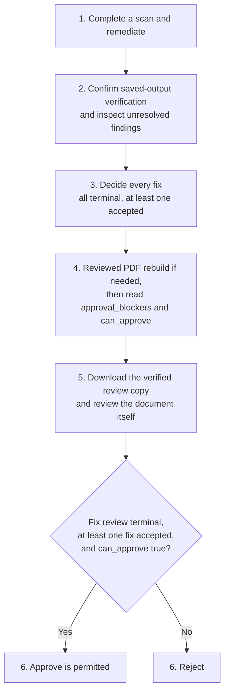

<h1 align="center">Document remediation</h1>

<p align="center"><strong>The canonical public guide to what Aelira Core's open-source implementation does with PDF, DOCX, PPTX, XLSX, and LaTeX content, and where a person still has to decide whether a change is correct.</strong></p>

<p align="center">
  <a href="pdf.md">PDF</a> ·
  <a href="office.md">Office</a> ·
  <a href="latex.md">LaTeX</a> ·
  <a href="reviewed-pdf.md">Reviewed PDF outcomes</a> ·
  <a href="general-stem.md">General STEM</a> ·
  <a href="../EVIDENCE_PACKAGES.md">Evidence packages</a> ·
  <a href="../../README.md">Aelira Core README</a>
</p>

> **Beta, not a compliance certificate.** A completed scan or remediated file is evidence from Aelira's checks, not proof that a document satisfies every applicable WCAG or format-specific requirement. Review and test the output with assistive technology and any validator required by your organization.
>
> **v0.9.7 boundary:** The immutable-source OCR, accessible-HTML sanitization, embedded-image validation, exact-byte managed-publication controls, and General STEM specialist pipeline described here are included in v0.9.7 and are still included in v0.9.13. They were not part of v0.9.5.

Aelira Core scans and can remediate PDF, DOCX, PPTX, XLSX, and LaTeX content. Choose a guide:

| Guide | What it covers |
|---|---|
|  **Format guides** | [PDF](pdf.md), [Office: DOCX, PPTX, XLSX](office.md), or [LaTeX](latex.md) |
|  **[PDF outcomes and reviewed working files](reviewed-pdf.md)** | Deterministic scoring, partial downloads and review-bound publication |
|  **[General STEM visual remediation](general-stem.md)** | The v0.9.7 specialist contracts and the printed equation and handwritten mathematics paths that the remediation pipeline runs in this release: detection, source association, specialist verification, saved-file verification, and human approval. It also describes the multi-equation, vector, chemical formula, molecular structure, commutative diagram and mixed composition code, which the pipeline does not use. |
|  **Focused semantic guides** | [commutative diagrams](commutative-diagrams.md), [chemical formulas](chemical-formulas.md), [molecular graphs](molecular-graphs.md), and the [handwritten-math suitability corpus](handwritten-math.md) |

## Format support and maturity

“Maturity” below describes evidence in this repository, not feature parity or a support guarantee.

| Input | Primary scan output | Remediation output | Evidence-based maturity |
|---|---|---|---|
| `.pdf` | Stored issue list, score, detected structure, and an HTML representation | `.pdf` | Broad processor tests plus a fixture-backed scan → remediate → re-scan integration test. This is the strongest document-format evidence, but complex semantics remain review work. |
| `.docx` | Stored categorized issues, score, structure counts, and HTML representation | `.docx` | Processor and edge-case tests cover Word structures; remediator and route wiring are tested. There is no claim of PDF-level end-to-end parity. |
| `.pptx` | Stored slide issues, score, and slide structure summary with read-only shape-order evidence | `.pptx` | Scanner has fixture-backed end-to-end tests plus animation/media tests. A bounded local-upload API and direct-library path persist explicitly accepted reading orders; PowerPoint/AT behavior still needs human verification. |
| `.xlsx` | Stored worksheet issues, score, and workbook structure summary | `.xlsx` | Focused integration tests cover pivot tables and conditional formatting; remediator and route wiring are tested. There is no full-workbook end-to-end parity claim. |
| `.tex` | Source issues plus equation conversion results (MathML and an optional review draft of each equation description, never stored as a label), score, and HTML | `.tex` by default; optional `.html` and `.pdf` | Source remediation and conversion branches are tested. The large processor E2E module is opt-in, and PDF quality depends on the converter available at runtime. |

The API's LaTeX conversion route also accepts `.txt`, `.md`, and `.pdf`; those are inputs to that route, not additional source-remediation formats. A PDF submitted there is dispatched to the PDF processor/remediator rather than converted back to TeX.

## Scan and remediation boundaries

Scanning reports evidence; remediation changes only categories that a format remediator considers eligible and for which required location/context data exists.

| Format | Scanning detects or analyzes | Remediation may change |
|---|---|---|
| PDF | Text/OCR state, metadata and language, tag/structure conditions, headings/lists/tables, reading order, images/alt text, links, forms, bookmarks, and generated HTML | Language/title metadata, bookmarks, selected structure/heading/list/table tags, and alt text where the structure tree and issue metadata permit a safe target |
| DOCX | Headings, images/alt text, tables, fake lists, link text, language, title, font size, SmartArt, and embedded objects | Image alt text, heading styles, fake-list formatting, first-row table headers, link text, run language, and title |
| PPTX | Image alt text, text contrast, slide titles, optional image-of-text OCR, animations, embedded media, and read-only current shape-order evidence | Eligible image alt text, text color, and missing slide titles. A local-upload reviewer or direct-library caller may supply a source-bound complete shape-ID order for a bounded slide repair; unreviewed suggestions remain manual. |
| XLSX | Sheet names, table/header structure, charts/images, merged cells, color-only cues, navigation/named ranges, pivot tables, and conditional formatting | Sheet names, table/header formatting, a missing chart title, text indicators for recognized colors, and frozen panes |
| LaTeX | Metadata/language, figures and captions, tables, equations without a `\label{}` for cross-referencing, MathML conversion with optional review drafts of equation descriptions, color-only emphasis and possible contrast, links, and list structure | TeX source for supported language, figure, heading, table, title, equation cross-reference label, color, and link cases (no generated equation description or ARIA label is written); requested conversions are a separate post-remediation step |

General STEM remediation is a PDF specialist layer rather than another input format. In this release the pipeline runs the printed equation and handwritten mathematics specialists. For those it binds each accepted visual to exact source evidence, applies only the matching typed specialist, reopens the saved PDF for reverse verification, and leaves the result unavailable until human approval of the exact current candidate. The multi-equation, vector, chemical formula, molecular structure, commutative diagram and mixed visual code is not used by the pipeline, although the review and gate services still validate stored contracts of the chemical formula, molecular structure and commutative diagram kinds. See the [General STEM guide](general-stem.md) for supported visual classes and refusal boundaries.

A finding can remain manual because its category is unsupported, its target is ambiguous, required metadata is absent, AI was unavailable or disallowed, or verification did not pass. Counts for fixed, manual, failed, and skipped work are part of the remediation result; “suggested fix” text is not evidence that a mutation occurred.

## Deterministic and AI-assisted work

- **Deterministic/rule-based:** file parsing; pattern and structural checks; score calculations; issue routing; metadata/language changes; known heading/list/table/navigation changes; format serialization; artifact hashing and authorization.
- **Optional AI capability:** descriptions and alt text, validation of existing descriptions, inferred titles/headings, chart/figure descriptions, and equation recognition can use a configured provider; for LaTeX source, an optional review draft of an equation description is also model-written and is never stored as an ARIA label. The alt text written for an equation in a PDF is not model-written: it is built deterministically from the recognized LaTeX, in closed spoken forms only, and ambiguous forms are refused for review (see [equation alt text](general-stem.md#equation-alt-text)). “Optional” means these capabilities can be disabled and deterministic scanning does not require a model; it does not mean every current route defaults its AI flags off.
- **Fail-closed boundary:** generated semantic content is not replaced with a success-shaped placeholder when the provider fails. The issue remains manual. Provider use and purpose are tracked by the remediation route.

<details>
<summary><strong>Generated image descriptions: math markup and control-character refusals</strong></summary>

<br>

The image-description prompts ask for mathematics in plain spoken words, with no LaTeX, markdown or math delimiters. A description that still carries math markup (a backslash command, a `$...$`, `\(...\)` or `\[...\]` span holding mathematics, a braced script, or a bare script such as `r^2`) is refused whole and never rewritten. The image stays open for human review with the manual reason `image_description_math_not_speakable`, and the single-image alt-text and chart-description routes answer `422` with a message saying why (the batch and comprehensive-analysis routes report the same message in their response body). Dollar signs count only around mathematics, so `$y = mx + b$` and `$ab$` are refused while `$5 and $10`, currency prefixes such as `US$100` and `A$5`, price tiers such as `$$ or $$$` and units such as `($M)` are not. A description that holds a control character, such as a NUL or an escape, or a direction override, is refused too; line breaks and tabs are not. A description without such markup is used unchanged, so prices and file paths are not touched. A description from a JSON answer in which a swallowed LaTeX command had to be repaired is refused, so a line break before `e.g.` in such an answer is refused too. Known limit: a description of a code screenshot that quotes `print("Hello\n")`, `\d+`, `m^2` or `A_1` reads as markup and is refused, and goes to manual review. The check runs when a description is generated: pending proposals created before this version are not re-checked, and human approval remains the gate for them. In a PDF, an image that the equation specialist recognized as an equation is not described by this generic path; it follows the stricter [equation alt text](general-stem.md#equation-alt-text) rules and otherwise stays manual.

</details>

The actual API defaults and explicit controls are route-specific:

- Direct remediation's `RemediationOptions.use_ai` defaults to `true`. Send `{"use_ai": false}` to `POST /education/remediate/{scan_id}` (that is, set `use_ai=false` in remediation options) when only rule-based fixes are acceptable. LMS-backed remediation has a separate explicit-intent policy and does not inherit that direct-upload default.
- For local uploads and Google Drive or Microsoft files, `generate_alt_text` defaults to `true`. While AI is on, image descriptions and equation recognition then use the workspace's configured provider, which receives those images. Send `{"generate_alt_text": false}` to keep both off; image findings then stay manual as a disabled category.
- `POST /education/pdf/scan` has `enhance_descriptions` defaults to `true` and `generate_alt_text` defaults to `false`; set `enhance_descriptions=false` with `?enhance_descriptions=false` to disable description enhancement, and leave `generate_alt_text=false` to keep alt-text generation off.
- The DOCX and PPTX scan routes default both `generate_alt_text` and `validate_alt_text` to `false`. The XLSX route defaults `generate_chart_descriptions` and `generate_alt_text` to `false`.
- `POST /education/latex/scan` has `use_ollama` defaults to `true`; set `use_ollama=false` with `?use_ollama=false` to disable it.

The same source can therefore have deterministic findings but different drafted language when a model is enabled. Disabling AI does not make every issue auto-fixable.

## Format preservation

PDF, DOCX, PPTX, and XLSX remediators save the same primary format as their input. LaTeX preserves remediated `.tex` source as the default and can additionally request HTML or PDF. PDF remediation works from a private copy and refuses an output path that resolves to the input, so the original PDF remains immutable.

“Same format” does not mean byte-for-byte preservation. The format libraries rewrite packages/objects, and unsupported or uncommon constructs may be normalized or lost. Compare the original and output visually and structurally, retain the original, and pay particular attention to signatures, forms, embedded objects/media, macros, formulas, pivots, animations, and complex layout.

## Managed artifacts and review

The direct and queued remediation APIs retain a scan-bound managed working artifact when remediation succeeds, applies at least one fix, produces saved output, and verification passes. A useful verified PDF can be downloaded for review and further manual work even when findings remain unresolved. This does not approve external publication. An artifact includes filename, MIME type, size, SHA-256, expiry, review status, lifecycle status, and approval blockers. Artifact access is tenant- and scan-scoped; download verifies the stored object before streaming it.

A typical review is:

1. Complete a scan and call `POST /education/remediate/{scan_id}`.
2. Confirm saved-output verification and the artifact ID in the response. Inspect unresolved findings and the recorded per-finding outcomes; a partial working file is not a conformance claim.
3. Fetch `GET /api/reviews/{scan_id}`. For every `ScanFix` that still needs a decision, call `POST /api/reviews/{scan_id}/fixes/{fix_id}` to approve, reject, or edit it. All fix decisions must be terminal (`auto_approved`, `approved`, or `rejected`), with at least one accepted fix (`auto_approved` or `approved`), before artifact approval.
4. If decisions edited or rejected included PDF changes, request a reviewed rebuild with `POST /education/pdf/remediate/{scan_id}` and wait for the durable job. Read the current artifact metadata and inspect `approval_blockers` and `can_approve`. Do not attempt approval while blockers remain.
5. Download the verified review copy from `GET /education/scans/{scan_id}/artifacts/{artifact_id}/download` and review the document itself.
6. Call `POST /education/scans/{scan_id}/artifacts/{artifact_id}/approve` only when the fix review is terminal, at least one fix is accepted, and `can_approve` is true; otherwise call `POST /education/scans/{scan_id}/artifacts/{artifact_id}/reject`.



In words: remediation and saved-output verification come first, then a terminal decision on every fix, then a reviewed rebuild when edited or rejected decisions included PDF changes, followed by a check of `approval_blockers` and `can_approve`. A person downloads and reviews the document itself. Approval is permitted only when the fix review is terminal, at least one fix is accepted, and `can_approve` is true; otherwise the artifact is rejected.

The legacy scan download routes remain implemented: `GET /education/scans/{scan_id}/remediated` and `GET /education/scans/{scan_id}/remediated/formats`. Prefer managed artifact metadata when the remediation response supplies an artifact ID because it carries integrity and review state.

After review, `GET /reviews/{scan_id}/audit/package` downloads a versioned evidence package. The manifest includes recorded provenance and review evidence while excluding source and output document bytes by default. See the [evidence-package contract](../EVIDENCE_PACKAGES.md) for explicit inclusion flags, compatibility rules, offline verification, and claim limits.

<details>
<summary><strong>Managed PDF publication: output claims, staging and cleanup</strong></summary>

<br>

Managed PDF publication has a stricter byte-identity boundary on `main`. The remediator creates PDF and optional HTML candidates in a private directory opened through retained directory descriptors, validates those candidates, and snapshots the exact validated PDF into a private, unlinked output claim before exposing the final pathname. The claim owns one read-only, non-inheritable descriptor; it has a single owner, is not serialized, and rejects copy, deep-copy, and pickle operations while live. Internal PDF verification and direct, queued, and Brightspace managed publication consume the exact claimed stream instead of reopening `output_file`.

`RemediationArtifactService` recomputes and checks size, SHA-256, MIME type, scan type, and filename while publishing that stream. Publication remains DB-first: a `staging` row and private publication token identify the exact attempt before bytes become `available`. Cancellation, ownership-fence loss, and completion-commit failure abort only that staging publication by artifact ID plus publication token. These controls narrow pathname races; they do not promise one-and-only-one external effects. Path-oriented compatibility remains for non-PDF formats and library consumers, but a managed PDF treats the output claim as authoritative.

Cleanup is part of the outcome. Candidate, serialization, working-copy, descriptor-close, or staging-abort failures produce an explicit cleanup warning or failed result, with a retained path or artifact ID when manual recovery is needed; no such failure is reported as success. See the self-hosting guide for recovery and platform limits.

</details>

See the [artifact service](../../src/services/remediation_artifact_service.py), [artifact route implementation](../../src/api/education/remediation_routes.py), and [artifact service tests](../../tests/test_remediation_artifact_service.py).

## Installation and dependencies

The supported repository installation is the full pinned set in [`requirements.txt`](../../requirements.txt); the annotated inventory is [`docs/DEPENDENCIES.md`](../DEPENDENCIES.md). Python is declared as 3.12 or newer in [`pyproject.toml`](../../pyproject.toml). The API-backed CLI requires Node 22 or newer and is packaged separately under the MIT license.

Major document dependencies are:

- PDF: pikepdf, PyMuPDF, pypdf, pdfplumber, OCRmyPDF, pdf2image, and pytesseract. OCR/conversion paths also need the corresponding system tools (Tesseract, Ghostscript/qpdf, and in some environments Poppler).
- Office: python-docx, python-pptx, openpyxl, Pillow, lxml, and optional Tesseract for PPTX image-of-text detection.
- LaTeX: latex2mathml for in-process equation conversion. Optional file conversion probes for LuaLaTeX/pdflatex, LaTeXML/latexmlpost, Pandoc, and Playwright/Chromium; unavailable tools select a weaker fallback or no converted file.

A model is not required for deterministic scanning. AI-assisted fields require a configured provider and may send document-derived content to that provider; use a local provider or keep AI options off when that egress is not acceptable.

## Entry points

### HTTP API

The scan uploads are asynchronous and return a `scan_id`:

- `POST /education/pdf/scan`
- `POST /education/word/scan`
- `POST /education/powerpoint/scan`
- `POST /education/excel/scan`
- `POST /education/latex/scan`

Poll `GET /education/scans/{scan_id}/progress`, then fetch `GET /education/scans/{scan_id}`. Authentication uses an `Authorization` header with a Bearer API key outside explicitly configured development mock auth. Routes are registered under `/education`, not `/api/education`.

### CLI

The API-backed command sources verify these command names:

```console
aelira scan pdf document.pdf --format json
aelira scan docx document.docx --format json
aelira scan ppt slides.pptx --format json
aelira scan xlsx workbook.xlsx --format json
aelira scan latex document.tex --format json
aelira remediate <scan_id> --download
```

These commands use the current API routes. `aelira scan latex` uploads the file to `POST /education/latex/convert` without setting `use_ollama`, so the route's default applies; to turn it off, use the multipart HTTP example in [the LaTeX guide](latex.md).

### Direct library

Only the PDF direct-library path has a maintained runnable example: [`examples/scan_pdf_direct.py`](../../examples/scan_pdf_direct.py). Processors and remediators are importable classes, but their return shapes and configuration are internal Python interfaces rather than a separately versioned SDK contract.

## Limitations and human review

- Aelira does not decide whether generated alt text, a heading hierarchy, a table header, a chart description, or a reading order conveys the author's intended meaning.
- It does not claim all-format parity. Scanner findings can outnumber safe mutations, and focused test depth differs by format.
- PPTX reading order is never inferred from the scan. The local-upload reviewer endpoint and direct-library path require an explicitly accepted order and leave PowerPoint/assistive-technology confirmation to a person. XLSX chart remediation may add a chart title; it should not be described as guaranteed chart alt text.
- Office serialization can affect macros and uncommon package parts; only `.docx`, `.pptx`, and `.xlsx` are accepted by their document scan routes, not legacy `.doc`, `.ppt`, or `.xls` files.
- OCR can misread scans. PDF tag repair cannot infer every semantic relationship in a complex layout.
- LaTeX HTML and PDF are separate conversion paths. LuaLaTeX/tagpdf, LaTeXML/Playwright, and pdflatex fallbacks have different accessibility properties.
- Validation in this repository is not a legal opinion, accessibility audit, or substitute for testing with people and assistive technology.

## Source and test evidence

| Area | Source | Tests |
|---|---|---|
| PDF | [processor](../../src/education/pdf_processor.py), [remediator](../../src/education/remediation/pdf_remediator.py), [structure writer](../../src/education/remediation/pdf_structure.py), [output claim](../../src/education/remediation/output_claim.py) | [processor E2E](../../tests/test_pdf_processor_e2e.py), [scan/remediate/re-scan](../../tests/test_pdf_remediation_integration.py), [OCR delivery](../../tests/test_pdf_ocr_remediation.py), [accessible HTML](../../tests/test_pdf_accessible_html_escaping.py), [output claim](../../tests/test_remediation_output_claim.py), [structure](../../tests/test_pdf_structure.py), [table headers](../../tests/test_pdf_table_headers.py) |
| DOCX | [processor](../../src/education/docx_processor.py), [remediator](../../src/education/remediation/docx_remediator.py) | [no-default-style](../../tests/test_docx_no_default_style.py), [SmartArt](../../tests/test_docx_smartart.py), [embedded objects](../../tests/test_docx_embedded_objects.py) |
| PPTX | [processor](../../src/education/pptx_processor.py), [remediator](../../src/education/remediation/pptx_remediator.py), [bounded reading-order repair](../../src/education/remediation/pptx_reading_order.py) | [processor E2E](../../tests/test_pptx_processor_e2e.py), [animations](../../tests/test_pptx_animations.py), [embedded media](../../tests/test_pptx_embedded_media.py), [saved reading order](../../tests/test_pptx_saved_reading_order.py) |
| XLSX | [processor](../../src/education/xlsx_processor.py), [remediator](../../src/education/remediation/xlsx_remediator.py) | [pivot tables](../../tests/test_xlsx_pivot_tables.py), [conditional formatting](../../tests/test_xlsx_conditional_formatting.py), [small-document scoring](../../tests/test_small_doc_scoring.py) |
| LaTeX | [processor](../../src/education/latex_processor.py), [remediator](../../src/education/remediation/latex_remediator.py), [converter](../../src/education/remediation/latex_converter.py) | [processor E2E (opt-in)](../../tests/test_latex_processor_e2e.py), [PDF/UA pipeline](../../tests/test_latex_pdf_ua.py), [download formats](../../tests/test_remediation_downloads.py), [siunitx](../../tests/test_latex_siunitx.py) |
| API/CLI | [scan routes](../../src/api/education/scan_routes.py), [remediation routes](../../src/api/education/remediation_routes.py), [artifact service](../../src/services/remediation_artifact_service.py), [CLI command sources](../../cli/src/commands) | [artifact service](../../tests/test_remediation_artifact_service.py), [direct PDF publication](../../tests/test_direct_pdf_claim_publication.py), [queued PDF publication](../../tests/test_queued_pdf_output_claim.py), [Brightspace PDF publication](../../tests/test_brightspace_pdf_output_claim.py), [outcome atomicity](../../tests/test_remediation_outcome_atomicity.py), [purpose-bound clients](../../tests/test_remediation_purpose_clients.py), [fail-closed alt text](../../tests/test_alt_text_fail_closed.py) |

<details>
<summary><strong>General STEM specialists: source and tests</strong></summary>

<br>

| Area | Source | Tests |
|---|---|---|
| Multi-equation visuals (not used by the pipeline in this release) | [region graph](../../src/education/multi_equation_region.py), [semantic contract](../../src/education/multi_equation_semantics.py), [PDF association](../../src/education/remediation/multi_equation_semantics.py) | [region detector](../../tests/test_multi_equation_region_detector.py), [semantic association](../../tests/test_multi_equation_semantic_association.py) |
| Vector equations (not used by the pipeline in this release) | [cluster contract](../../src/education/vector_equation_cluster.py), [semantic contract](../../src/education/vector_equation_semantics.py), [PDF association](../../src/education/remediation/vector_equation_semantics.py) | [cluster detector](../../tests/test_vector_equation_cluster_detector.py), [semantic association](../../tests/test_vector_equation_semantic_association.py) |
| Chemical formula semantics (not used by the pipeline in this release) | [typed parser, speech, and MathML contract](../../src/education/chemical_formula.py), [PDF specialist](../../src/education/chemical_formula_pdf.py) | [semantic contract](../../tests/test_chemical_formula.py), [PDF contract](../../tests/test_chemical_formula_pdf_contract.py), [saved association](../../tests/test_chemical_formula_pdf_association.py) |
| Molecular graph semantics (not used by the pipeline in this release) | [typed graph, topology, identity, and description contract](../../src/education/molecular_graph.py), [PDF specialist](../../src/education/chemical_structure_pdf.py) | [semantic contract](../../tests/test_molecular_graph.py), [PDF contract](../../tests/test_chemical_structure_pdf_contract.py), [saved association](../../tests/test_chemical_structure_pdf_association.py) |
| Commutative diagrams (not used by the pipeline in this release) | [typed graph and description contract](../../src/education/commutative_diagram.py), [PDF specialist](../../src/education/commutative_diagram_pdf.py) | [semantic contract](../../tests/test_commutative_diagram_contract.py), [PDF contract](../../tests/test_commutative_diagram_pdf_contract.py), [saved association](../../tests/test_commutative_diagram_pdf_association.py) |
| Handwritten math | [suitability contract](../../src/education/handwritten_math_suitability.py), [HMER recognizer](../../src/education/remediation/handwritten_equation_recognizer.py), [agreement verifier](../../src/education/remediation/handwritten_equation_verifier.py), [frozen corpus](../../tests/fixtures/handwritten_math/manifest.json) | [corpus and policy](../../tests/test_handwritten_math_suitability.py), [recognition and verification](../../tests/test_handwritten_math_recognition.py), [PDF routing](../../tests/test_handwritten_math_fixer.py) |
| Mixed STEM composition (router and composer not used by the pipeline in this release) | [region graph](../../src/education/mixed_stem_regions.py), [router](../../src/education/remediation/mixed_stem_region_router.py), [composition contract](../../src/education/mixed_stem_composition.py), [composer](../../src/education/remediation/mixed_stem_composer.py) | [routing](../../tests/test_mixed_stem_region_routing.py), [composition](../../tests/test_mixed_stem_composition.py) |

</details>
