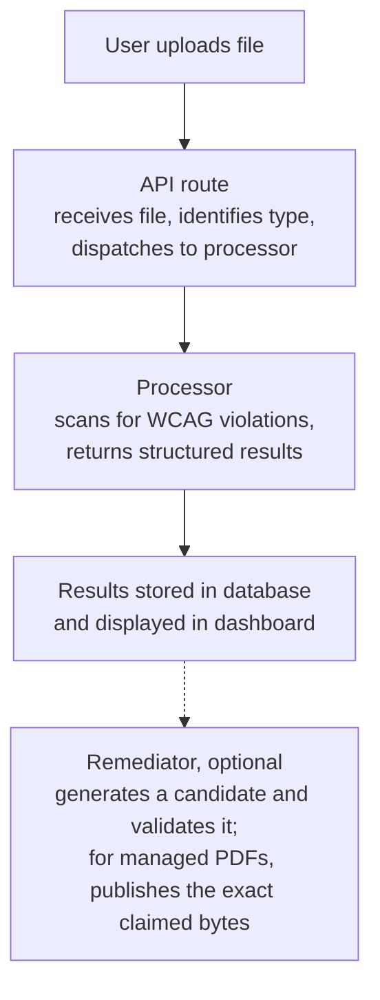

<h1 align="center">Examples</h1>

<p align="center"><strong>Working examples for the three ways to drive Aelira Core: the engine as a library, the HTTP API, and the CLI.</strong></p>

<p align="center">
  <a href="#1-scan-a-document-with-the-engine-directly">Engine</a> ·
  <a href="#2-scan-through-the-api">HTTP API</a> ·
  <a href="#3-scan-from-the-command-line">CLI</a> ·
  <a href="#add-a-new-document-processor">New processor</a> ·
  <a href="../docs/document-remediation/README.md">Document remediation hub</a>
</p>

> **Scope.** Each example is runnable as-is and is verified against the code in this repository. The v0.9.7 PDF safety architecture keeps the source immutable and publishes managed PDF remediation from an exact-byte output claim. The direct example below scans only; managed remediation additionally uses the lifecycle described in the hub.

For format-by-format scan and remediation boundaries, dependencies, current API and CLI entry points, output expectations, and human-review guidance, start with the [document remediation hub](../docs/document-remediation/README.md).

| Example | What it shows | Needs a running server? |
|---|---|---|
| [`scan_pdf_direct.py`](scan_pdf_direct.py) | Scan a PDF by importing the engine directly. Embed the processors in your own batch job or CI check. | No |
| [`api_scan.sh`](api_scan.sh) | Submit a scan over HTTP, poll progress, fetch results | Yes |
| [`custom_processor.py`](custom_processor.py) | Add support for a new file format: issue models, the scan interface, registration | No (reference code) |

## 1. Scan a document with the engine directly

The processors are plain Python classes with no web framework attached. `scan_pdf_direct.py` scans a bundled test fixture (or any PDF you pass) and prints the compliance score and each issue:

```console
$ DATABASE_URL=postgresql://localhost/unused JWT_SECRET=dev-only \
      python examples/scan_pdf_direct.py
File:             /path/to/aelira-core/tests/fixtures/pdfs/simple_syllabus.pdf
Compliance score: 47.4
Issues found:     8
  [medium] accessibility_issue (page 1): Document should start with H1 heading
  [high] missing_language (page 1): PDF document language not set
  ...
```

The settings module requires `DATABASE_URL` and `JWT_SECRET` at import time, even though this example never touches the database.

The score describes completed automated checks, not accessibility conformance. If a required check cannot complete, the example prints `Scan incomplete:` to stderr, exits with status 1 and does not print a score. For example, `tests/fixtures/pdfs/academic_paper.pdf` currently exercises that outcome.

The same pattern works for the other processors (`docx_processor`, `pptx_processor`, `xlsx_processor`, `latex_processor`), which share the scan-and-return-issues shape shown in `custom_processor.py`.

## 2. Scan through the API

`api_scan.sh` drives the asynchronous scan flow end to end: upload returns a `scan_id` immediately, progress is polled at `/education/scans/{scan_id}/progress`, and the full result comes from `/education/scans/{scan_id}`.

```console
$ AELIRA_API_KEY=aelira_live_... sh examples/api_scan.sh syllabus.pdf
```

Create an API key in the dashboard under Settings → API Keys. Other formats use the same pattern:

| Format | Route |
|---|---|
| Word | `/education/word/scan` |
| PowerPoint | `/education/powerpoint/scan` |
| Excel | `/education/excel/scan` |
| LaTeX | `/education/latex/scan` |

## 3. Scan from the command line

The CLI wraps the API flow above with progress display and formatted output:

```console
$ npx @aelira/cli scan pdf syllabus.pdf
```

See the [CLI README](../cli/README.md) for authentication and the full command set.

## Add a new document processor

[`custom_processor.py`](custom_processor.py) is a complete example of adding support for a new file format. It shows how to:

- Define issue models using Pydantic
- Create a processor class with the standard scan interface
- Return structured results compatible with the dashboard
- Register the processor with the API

## Architecture overview



In words: the API route receives the uploaded file, identifies its type and dispatches it to a processor. The processor scans for WCAG violations and returns structured results, which are stored in the database and displayed in the dashboard. Optionally, a remediator generates a candidate, validates it, and for managed PDFs publishes the exact claimed bytes.

Each processor follows the same pattern:

1. Accept a file path or bytes
2. Parse the document format
3. Check for WCAG 2.1 AA violations
4. Return a list of issues with locations, severity, and suggested fixes
